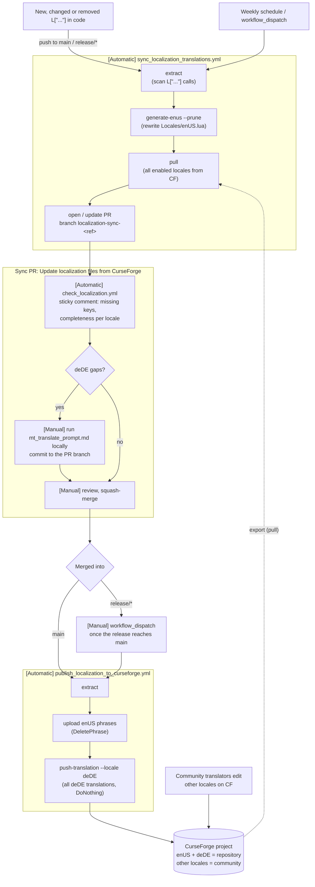

# Localization Update Process

This page documents the end-to-end flow for keeping `Locales/*.lua` in sync with the code and with
CurseForge (CF) community translations — from a new `L["..."]` string appearing in code to it
showing up translated in-game. Three GitHub Actions workflows and one locally-run AI-assistant prompt
make up the pipeline; each step below is marked **Automatic** (CI, no action needed) or **Manual**
(a human has to do something).

For the deDE-specific machine-translation step itself, see
[`mt_translate_prompt.md`](../mt_translate_prompt.md). This page is the surrounding process it fits
into.

---

## Overview

CF never reads the source code: it only knows the phrases the publish workflow `upload`s (from its
own `extract` of `main`), and the deDE translations `push-translation` sends. Everything that
changes on CF reaches the repository only through a sync PR - other locales' community
translations included - and only once that PR is merged.

**enUS and deDE are maintained in this repository** and never edited on CF. CF only receives them
(Step 5); `pull` never replaces a local deDE text with CF's (`REPO_AUTHORITATIVE_LOCALES` in
`Source/localization_tool.py`). All other locales are translated by the community on CF and pulled
from there.

---

## Step 1 — [Automatic] `sync_localization_translations.yml`

Runs on push to `main` and `release/*`; also weekly (catches CF-side community translation
edits with no accompanying code change) and via manual `workflow_dispatch`. `hotfix/*` is
deliberately not a trigger - each hotfix branch used to get its own sync PR with a diff identical
to the release/main one; a hotfix's new strings are picked up once it is merged forward.

1. `extract` — scans all `.lua` files for `L["..."]` calls.
2. `generate-enus --prune` — regenerates `Locales/enUS.lua` mechanically from that scan (plus
   `Source/LocalizationSpecialPhraseKeys.lua` for documented dynamic-key overrides). `--prune` drops
   any enUS key the scan no longer finds — safe because every dynamic `L[expr]` site the AST scan
   can't resolve is expected to already have its possible keys documented in that registry file; see
   `cmd_generate_enus`'s docstring in `Source/localization_tool.py` for the full reasoning.
3. `pull` — downloads current CF translations for every `Locales.xml`-enabled locale. Never
   regresses or drops a locally existing translation: if CF reports a key as
   `--[[Translation missing --]]`, the existing local translation (and its
   `--[[Machine translation --]]` marker, if any) is kept instead of the placeholder; if CF
   doesn't know the key at all yet (its enUS phrase hasn't reached CF via Step 5's `upload` -
   see the note below on that), the existing local translation is carried over unchanged
   rather than silently dropped. For deDE, a local translation also wins over a different text
   on CF (e.g. an older one, before Step 5 uploaded the correction), marker included. For the
   other locales, CF's translation wins; the marker is only kept while CF's text is still exactly
   the local machine translation.
   The locale files are also aligned to the `enUS.lua` regenerated in step 2: entries for keys
   no longer in it are dropped (CF still exports them until Step 5's `upload` deletes the
   phrase), and a key new in it gets a `--[[Translation missing --]]` placeholder (CF doesn't
   know it before Step 5). So the PR already shows removed and new strings for every locale.
   See `preserve_existing_translations()` in `Source/localization_tool.py`.
4. Opens (or updates, if one is already open) a PR titled **"Update localization files from
   CurseForge"** on branch `localization-sync-<ref>`.

Checkout and PR creation use a personal access token (the `PAT_TOKEN` repo secret), not the
default `GITHUB_TOKEN`. A PR opened under `GITHUB_TOKEN` is attributed to
`github-actions[bot]`, and GitHub then requires a maintainer to manually click "Approve and
run workflows" before `pull_request`-triggered workflows (Step 2) run on it - same gate as a
first-time contributor's fork PR. `PAT_TOKEN` avoids that entirely.

Nothing to do here unless something looks wrong in the resulting PR (see Step 2).

## Step 2 — [Automatic] `check_localization.yml` comment on the PR

Posts a sticky comment on the sync PR with:

- Any key used in code but missing from `enUS.lua` (should never happen if Step 1 ran cleanly).
- Per-locale completion, split as e.g.:
  `deDE : 928/1016 (91.3%) human-reviewed, +37 machine-translated pending review (95.0% total)  51 missing`
  — human-reviewed vs. machine-translated-pending-review counts come from whether a
  `--[[Machine translation --]]` marker comment sits directly above the entry in `Locales/deDE.lua`.

Read this to decide whether Step 3 is needed.

## Step 3 — [Manual, only if deDE has new gaps] Run the MT prompt locally

If the comment from Step 2 lists new/untranslated deDE strings, run
[`Source/mt_translate_prompt.md`](../mt_translate_prompt.md) via an AI coding assistant with local
git/shell access (e.g. Claude Code, or an equivalent agentic tool), pointed at the sync PR's branch.
It:

- Filters out false positives (keys that already carry an intentional English-loanword translation,
  not a real CF placeholder gap).
- Filters out keys still reachable only via a since-removed feature (dead code the scan no longer
  finds, `--prune` territory, not a translation gap) and keys used as literal in-game NPC/unit name
  matches (never guess those — a wrong Blizzard-official name silently breaks the match).
- Translates the remainder, reusing this project's established German terminology, and marks each
  new entry with `--[[Machine translation --]]`.
- Checks the terminology of all `--[[Machine translation --]]`-marked entries against the
  human-reviewed ones and reports deviations (e.g. "apply" rendered as "wirken" where the rest of
  the file uses "anwenden"). Corrections, also of entries already on CF, are simply committed -
  Step 5 uploads them after the merge.
- Shows the full diff and an English → German overview table, and waits for explicit confirmation
  before committing/pushing anything.
- Commits and pushes onto the *same* PR branch (adds a commit to the existing sync PR, never opens
  a new one).

This is deliberately **not** wired into CI — no AI-provider API key is set up as a secret in this
repo for it. It runs under the maintainer's own AI-assistant session/subscription instead of a
metered API billed straight to the repo.

## Step 4 — [Manual] Review and merge the sync PR

Review the diff (mechanical enUS regeneration + pulled community translations + any MT deDE
additions) like any other PR, then merge.

**Merge method: prefer squash-merge over rebase-merge.** `sync_localization_translations.yml` has a
self-skip guard (`!contains(github.event.head_commit.message, 'Update localization files from
CurseForge')`) so merging its own PR back into a trigger branch doesn't immediately re-open a
duplicate PR. Squash-merge and ordinary merge-commit both default to the PR title as the resulting
commit message, so the guard matches. Rebase-merge instead lands each original commit with its own
message — if the last one isn't the PR title, the guard misses and the workflow harmlessly (but
uselessly) re-runs.

## Step 5 — [Automatic, main only] `publish_localization_to_curseforge.yml`

Triggers when a PR from a `localization-sync-*` branch is merged into `main` (the sync PR from
Step 4), or manually via `workflow_dispatch` - e.g. for a sync PR merged into a `release/*` branch,
whose changes reach `main` later with the release merge, which does not trigger this workflow.

1. `extract` (fresh scan of `main`).
2. `upload` — pushes new/changed enUS phrases to CF (`DeletePhrase`: a phrase no longer present is
   removed from CF too, e.g. after a wording fix).
3. `push-translation --locale deDE` — uploads *every* deDE translation to CF: reviewed entries,
   `--[[Machine translation --]]`-marked entries and loanwords kept in English; only CF's
   `--[[Translation missing --]]` placeholders and keys no longer in `enUS.lua` are left out
   (`DoNothing`: never deletes anything on CF). Corrections of texts already on CF reach it the
   same way. No `pull` beforehand - it would replace the local texts with CF's older ones.

Nothing to do here — this is the only step in the whole pipeline that actually writes to CurseForge,
and it's fully automatic once the sync PR is merged into `main`.

## Reviewing machine translations

A `--[[Machine translation --]]` marker only means "not reviewed yet" - it does not change what is
uploaded. To sign off a machine translation, correct it if needed and delete its marker line in
`Locales/deDE.lua` by hand; `pull` never adds or removes a deDE marker.

---

## Manual housekeeping (not part of the automated flow)

- **Stale sync PRs on abandoned branches.** A `localization-sync-<branch>` PR only updates in place
  for pushes to the *same* branch; a hotfix/release branch that's merged forward and then abandoned
  (not deleted) leaves its sync PR open forever with nobody closing it. Check periodically
  (`gh pr list --search "Update localization files from CurseForge" --state open`) and close/merge
  as appropriate. Before merging one, check whether its "new" enUS strings were already
  machine-translated on another branch in the meantime — merging an old pull would overwrite a
  proper translation with CF's untranslated placeholder from before it existed.
- **Branch cleanup after merge.** `delete_branch_on_merge` is enabled repo-wide, so GitHub
  auto-deletes a `localization-sync-*` branch once its PR is merged (does *not* apply to PRs closed
  without merging, or to branches that already existed before this setting was turned on).
- **Not every branch runs the same version of this tooling.** CF phrase state is shared
  globally across the whole project, but each branch's `Locales/*.lua` and
  `Source/localization_tool.py` are independent until merged. A branch still running an
  older, unmigrated `sync_localization_translations.yml` (e.g. one with its own unconditional
  `upload` step, pre-dating Step 5's merge-gated split) can upload an enUS phrase to CF that
  another branch also happens to contain in its code - CF then starts reporting it (as a
  placeholder, or later a real translation) to that other branch's own `pull`, even though
  that branch never uploaded it itself. `pull`'s preserve logic (Step 1) handles this
  correctly, but only once every branch has that logic - if in doubt, verify an unexpected
  `pull` diff on a locale file rather than trusting it at face value.
